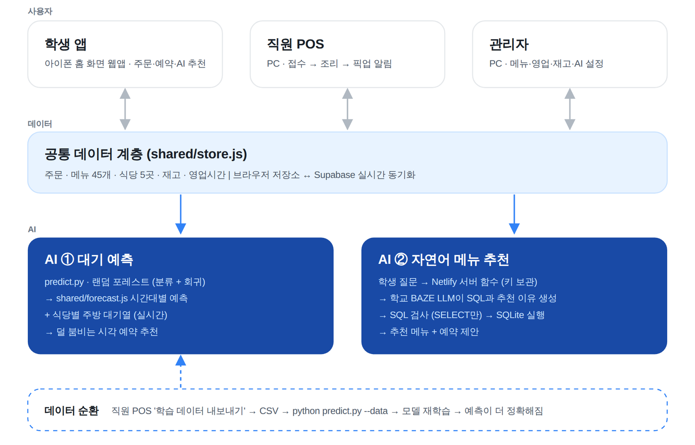
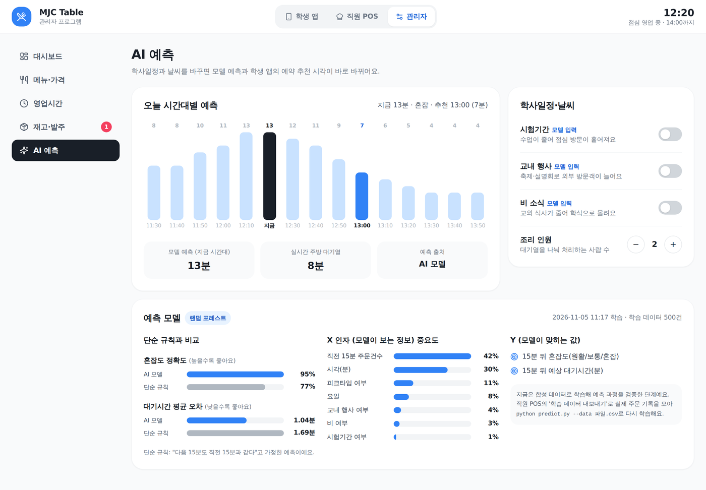
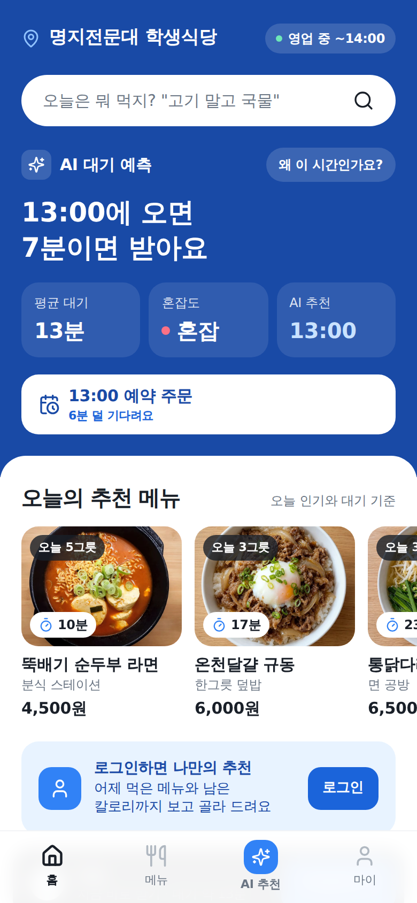
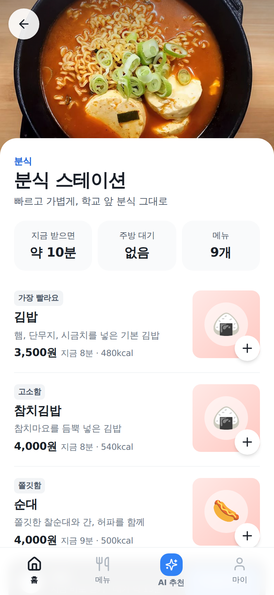
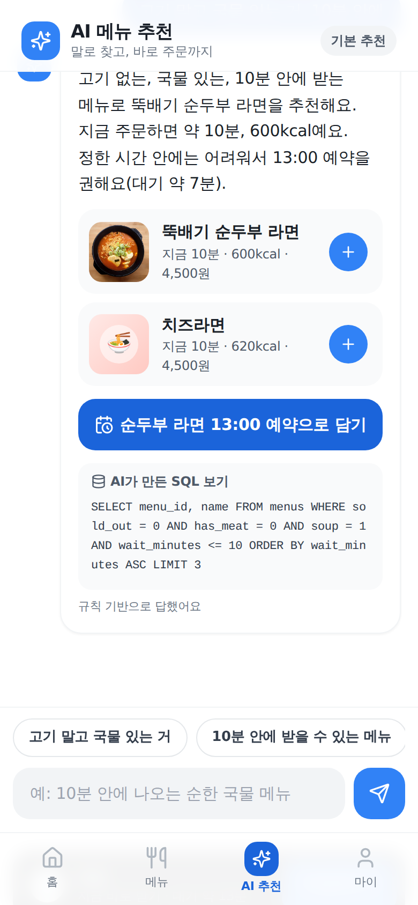
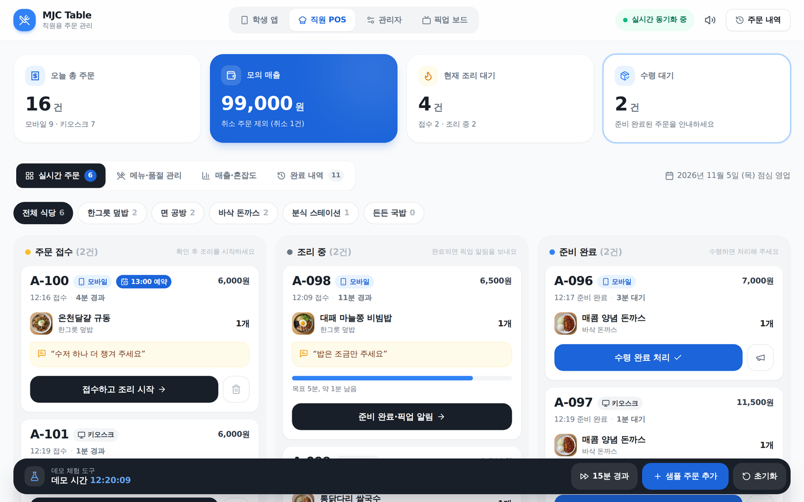
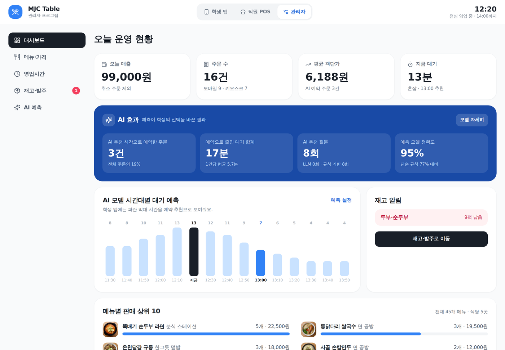

# MJC Table · 줄 서지 않는 학생식당

명지전문대 학생식당을 위한 스마트오더 플랫폼입니다. **학생 앱, 직원 POS, 관리자 프로그램** 3개가 하나의 데이터로 실시간 연결되고, AI가 **점심 대기를 예측해 덜 붐비는 시간으로 예약하도록** 돕고, **말로 물어보면 오늘 메뉴에서 알맞은 메뉴를 찾아** 줍니다.

> AI:ON 2026 AI 경진대회 · 팀 모몽가 (박준영, 김은별)

| 바로 가기 | |
| --- | --- |
| 데모 | `[Netlify 주소를 여기에]` |
| 시연 영상 | `[영상 링크를 여기에]` |
| 시스템 구조 | [docs/architecture.html](docs/architecture.html) |
| 설치·배포 | [docs/SETUP.md](docs/SETUP.md) |



---

## 1. 문제 정의

- **학생:** 점심 피크(11:30~13:30)에 학생식당 줄이 길어 쉬는 시간 안에 식사하기 어렵고, 지금 가면 몇 분 기다릴지 알 수 없어요.
- **조리실 직원:** 주문이 한꺼번에 몰리고 어느 메뉴가 언제 나갈지 한눈에 보기 어려워요.
- **위탁 운영사(관리자):** 피크 인력 배치, 품절, 재료 발주를 경험에 의존해요.

**목표:** 대기 시간을 미리 알려주는 데서 끝나지 않고, **학생이 덜 붐비는 시간에 예약하도록 행동을 바꾸는 것**이에요. (멘토링 피드백: "예측이 행동을 바꿔야 의미가 있다")

## 2. AI 도구·활용 방식

| AI | 하는 일 | 사용 기술 |
| --- | --- | --- |
| **① 대기 예측** | 시간대별 15분 뒤 혼잡도와 대기시간을 예측하고, 식당별 주방 대기열과 합쳐 메뉴별 예상 수령 시간과 **예약 추천 시각**을 제시 | Python, scikit-learn RandomForest (분류 + 회귀) |
| **② 자연어 메뉴 추천** | "고기 말고 국물 있는 거, 10분 안에" 같은 질문을 **SQL로 바꿔** 오늘 메뉴에서 찾고, 시간 안에 못 받으면 예약을 제안 | 학교 BAZE LLM 게이트웨이(OpenAI 호환), sql.js(SQLite), Netlify Functions |

- **X 인자(모델 입력):** 시각, 요일, 직전 15분 주문 수, 시험기간, 교내 행사, 비, 피크타임 여부
- **Y(맞히는 값):** 15분 뒤 혼잡도(원활·보통·혼잡), 15분 뒤 예상 대기시간(분)
- **검증:** "다음 15분도 직전과 같다"는 단순 규칙과 비교 → 혼잡도 정확도 **95% vs 77%**, 대기시간 평균 오차 **1.04분 vs 1.69분** (합성 데이터 500건 기준)
- **데이터 순환:** 직원 POS의 'AI 학습 데이터 내보내기' → `python predict.py --data 파일.csv` → 실제 주문 기록으로 재학습
- **AI 효과 측정:** 관리자 대시보드에서 'AI 추천 시각으로 예약한 주문 수', '예약으로 줄인 대기 합계', 'AI 추천 질문 수'를 실시간으로 집계
- **책임 있는 사용:** API 키는 서버에만, LLM이 만든 SQL은 실행 전 검사(SELECT·menus 표만), 비회원은 개인 기록 없이 추천, 요청 수 제한, LLM이 끊겨도 규칙 기반으로 동작
- **개발 과정의 AI:** 기획·디자인·코드 초안은 Claude(학교 제공 Pro)로 만들고, 팀이 화면을 직접 눌러 검증하고 수정했어요. (예: 글자 대비 부족, 키 노출 위험, 브랜드 이미지 사용 위험을 찾아 고침)



## 3. 구현 단계·결과물

| 단계 | 내용 |
| --- | --- |
| 1. 기획 | 학생식당 키오스크 + 혼잡도 예측으로 시작 |
| 2. 멘토링 반영 | 키오스크 → **학생 앱 + 직원 POS + 관리자** 플랫폼으로 확장, X 인자 정리, UI 개선 |
| 3. UI | 배민의 정보 구조 + 토스의 색(#3182F6), 시안 → 실제 화면 |
| 4. 구현 | 프로그램 3개, 식당 5곳·메뉴 45개, 주문 → 조리 → 픽업 알림 실시간 연동, 재고·발주, 영업 관리 |
| 5. AI 연결 | 예측 모델 출력(`shared/forecast.js`)을 세 프로그램이 직접 사용, LLM 자연어 추천 |
| 6. 검증 | 브라우저 자동 테스트로 주문 연동, 품절·휴무 반영, AI 응답 처리 확인 |

| 학생 앱 홈 | 식당 | AI 추천 |
| --- | --- | --- |
|  |  |  |

| 직원 POS | 관리자 대시보드 |
| --- | --- |
|  |  |

## 4. 팀원별 역할·멘토링

| 이름 | 역할 |
| --- | --- |
| 박준영 (팀장) | 기획, 데이터·AI 모델(predict.py), AI 연동, 발표 |
| 김은별 | 화면 설계·구현(학생 앱·POS·관리자), 데이터 연동, 시연 영상 |

| 멘토링 피드백 | 반영 결과 |
| --- | --- |
| 키오스크에 대기시간만 붙인 수준 → 플랫폼으로 | 학생 앱·직원 POS·관리자 3개 프로그램, 개인 추천·칼로리 기록 |
| 예측이 행동을 바꿔야 의미가 있음 | 예약 추천 시각 + 'AI 효과' 집계 |
| X 인자를 정할 것 | 시험기간·행사·비를 모델 입력에 추가, 중요도 시각화 |
| 자연어 주문 (LLM + SQL) | NL2SQL 추천, 'AI가 만든 SQL 보기' |
| UI가 AI 티가 나지 않게 | 실제 음식 사진, 토스 색 체계로 전면 개편 |
| 아키텍처를 그림으로 | [docs/architecture.html](docs/architecture.html) |

## 5. 2단계 계획

1. **실제 데이터로 재학습:** 운영 중 쌓이는 주문 기록으로 모델을 다시 학습하고 오차를 공개
2. **실서비스 구조:** Supabase DB와 학교 계정 로그인, 주문번호·가격 계산을 서버에서 처리
3. **알림·예약 운영:** 푸시 알림, 픽업 시간대, 노쇼 규칙
4. **운영자 AI:** 하루 운영 요약과 다음 날 인력·발주 제안(LLM), 음식 폐기 줄이기
5. **사용자 검증:** 학우 대상 사용 테스트로 대기 시간 변화 측정
6. **확장:** 같은 구조로 다른 캠퍼스 식당·키오스크에 적용

---

## 실행 방법

```bash
# 1) 화면 실행 (아무 정적 서버나 가능)
python3 -m http.server 8000
# → http://localhost:8000  (학생 앱 /app, 직원 POS /pos, 관리자 /admin, 구조 /docs/architecture.html)

# 2) 예측 모델 학습 → shared/forecast.js 갱신
pip install -r requirements.txt
python3 predict.py
python3 predict.py --data mjc_orders_20261105.csv   # POS에서 내보낸 실제 주문으로 재학습
```

- 같은 브라우저 탭끼리는 바로 연동돼요. 직원 POS 하단 '초기화'로 시연 데이터를 복원해요.
- AI 키 설정, Netlify 배포, 기기 간 연동(Supabase)은 [docs/SETUP.md](docs/SETUP.md)를 보세요. **API 키는 코드에 넣지 않아요.**

## 파일 구조

```
index.html               시작 페이지
app/ pos/ admin/         학생 앱 · 직원 POS · 관리자
shared/store.js          공통 데이터, 예측 계산, 재고, 로그인
shared/ai.js             자연어 메뉴 추천 (LLM + NL2SQL + 규칙 기반 대체)
shared/forecast.js       predict.py가 만든 모델 예측 (자동 생성)
shared/supabase-sync.js  기기 간 실시간 동기화 (선택)
netlify/functions/ai.js  LLM API 키를 서버에만 두는 함수
predict.py               대기 예측 모델 학습·추론·내보내기
schema.sql               MySQL 설계, supabase_setup.sql  Supabase 설정
docs/                    아키텍처, 설치 안내, 화면 캡처, 중간보고서 초안
```

## 데이터 고지

식당 구성(5곳·메뉴 45개), 가격, 칼로리, 주문 수치(16건·99,000원), AI 사용 집계는 **시연용 가상 데이터**예요. 예측 모델은 합성 데이터로 예측 과정을 검증한 단계이며, 실제 성능은 운영 데이터로 다시 평가할 예정이에요.
